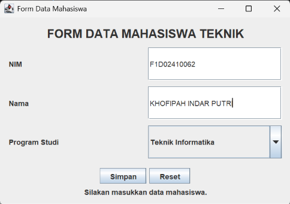
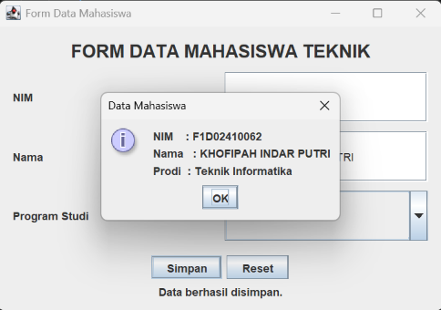

# GUI Form Data Mahasiswa

## Deskripsi
Program ini merupakan latihan pembuatan GUI menggunakan Java Swing.  
Program digunakan untuk memasukkan data mahasiswa berupa NIM, nama, dan program studi.

## 1. Top-level Container Class

### JFrame
`JFrame` digunakan sebagai container utama atau jendela utama aplikasi GUI.

Pada program ini, `JFrame` digunakan untuk menampilkan seluruh komponen form mahasiswa.

## 2. Intermediate Container Class

### JPanel
`JPanel` digunakan sebagai container untuk mengelompokkan beberapa komponen GUI.

Pada program ini digunakan beberapa `JPanel` untuk mengatur bagian form, tombol, dan status.

## 3. Atomic Component Class

Komponen atomic yang digunakan antara lain:

- `JLabel` untuk menampilkan teks.
- `JTextField` untuk menerima input NIM dan nama.
- `JComboBox` untuk memilih program studi.
- `JButton` untuk menjalankan aksi Simpan dan Reset.

## 4. Layout Classes

Program menggunakan tiga jenis layout:

### BorderLayout
Digunakan untuk membagi area utama JFrame menjadi beberapa bagian.

### GridLayout
Digunakan untuk menyusun komponen form dalam bentuk baris dan kolom.

### FlowLayout
Digunakan untuk menyusun tombol Simpan dan Reset secara horizontal.

## 5. Event Listener

Program menggunakan `ActionListener` untuk menangani event ketika tombol ditekan.

Method yang digunakan:

```java
@Override
public void actionPerformed(ActionEvent e)
```

Method tersebut digunakan untuk menangani aksi tombol Simpan dan Reset.

## Screenshot

### Tampilan Awal



### Setelah Data Disimpan

